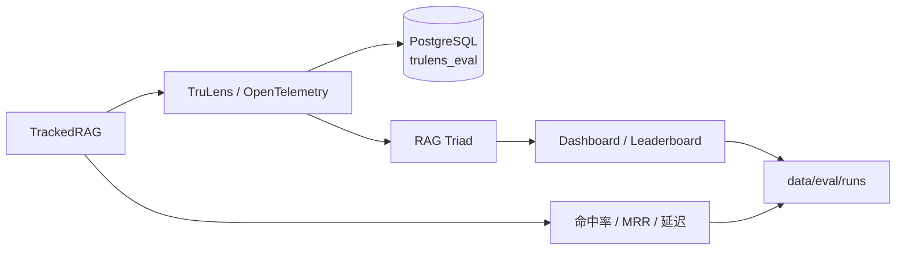

# RAG 评估报告：检索策略与药品说明书切块

> 状态：阶段性评估（每个配置 10 条样本）
> 评估框架：TruLens 2.16 + RAG Triad + Hit Rate / MRR + Latency
> 最后更新：2026-11-11

## 摘要

本报告评估医疗 Agent 项目的文档 RAG 链路，覆盖两个知识库场景：

- **CMIRB 医学问答语料**：约 9.9 万条
- **药品说明书**：2 份 PDF，32 个章节块

评估目标是回答三个问题：

1. 当前 RAG 基线处于什么水平？
2. Reranker、Query 改写、HyDE、TopK 是否真的有效？
3. 不同知识库是否应该使用不同的检索配置？

主要结论：

| 场景 | 推荐配置 | 关键依据 |
|---|---|---|
| CMIRB | Reranker + TopK 20 | 上下文相关性 0.49→0.61，答案相关性 0.67→0.90 |
| 药品说明书 | 章节感知切块 + Top3，不启用 Reranker | Hit Rate/MRR=1.0；Reranker 延迟翻倍且指标不涨 |
| Query 改写 | 默认关闭 | 口语语料 + 单子查询截断，收益为负 |
| HyDE | 默认关闭 | 召回漂移，延迟最高 |

> 所有数字均来自阶段性小样本评估，用于方向判断，不作为最终性能承诺。

## 1. 背景与范围

### 1.1 背景

项目原有文档 RAG 链路已具备 Query 改写、HyDE、Milvus 向量检索、qwen3-rerank 精排和基于上下文的生成，但缺少统一评估：

- 无法量化当前基线
- 无法判断某个优化是否真的有效
- 无法比较不同知识库的最优配置

### 1.2 评估范围

**包含：**

- 文档 RAG：向量检索、Reranker、HyDE、Query 改写、TopK
- 药品说明书 PDF 解析与章节切块
- TruLens RAG Triad 与检索命中率评估

**不包含：**

- GraphRAG、NL2SQL、处方审核的独立评估
- 多轮对话、长期记忆质量
- 生产环境的鉴权、PII、限流、成本控制

## 2. 系统与评估架构

### 2.1 RAG 链路


### 2.2 评估链路



### 2.3 关键组件

| 组件 | 作用 |
|---|---|
| `src/agents/knowledge/doc_rag.py` | 向量检索、上下文格式化、生成 |
| `src/agents/knowledge/hyde.py` | HyDE 假设性回答 |
| `src/agents/knowledge/reranker.py` | qwen3-rerank 精排 |
| `src/agents/knowledge/query_rewriter.py` | Query 改写 |
| `src/agents/knowledge/evaluation/` | TruLens 配置、指标、可追踪 RAG |
| `scripts/run_rag_experiments.py` | 多版本实验入口 |
| `scripts/prepare_eval_dataset.py` | 评估数据集生成 |
| `scripts/import_drug_pdfs.py` | 药品说明书解析与章节切块 |

## 3. 评估方法

### 3.1 RAG Triad

| 指标 | 定义 | 低分含义 |
|---|---|---|
| 上下文相关性 | 每个检索片段与问题的相关程度 | 检索噪声大、召回不准 |
| 有据性 | 回答中的声明能否被检索内容支撑 | 幻觉或上下文不足 |
| 答案相关性 | 回答是否切题 | 答非所问、Prompt 跑偏 |

实现方式：TruLens `Metric` + `Selector`，由 DeepSeek 作为 Judge LLM 逐条打分并给出 CoT 理由。

### 3.2 检索指标

- **Hit Rate**：正确片段/章节是否出现在最终 TopN
- **MRR**：正确片段/章节排名的倒数均值
- **Latency**：端到端耗时

CMIRB 题使用 `expected_chunk_id` 精确匹配；药品题使用 `doc_name + expected_section` 做章节级匹配。

### 3.3 判定规则

1. **不单独用上下文相关性选配置**：它是每个片段的平均分，上下文数量不同时不可直接比较。
2. 同时参考有据性、答案相关性、延迟和答案完整性。
3. 每个配置 10 条样本，结论仅作方向判断；正式评估建议 30~50 条。
4. 关键结论至少复跑一次，避免 LLM Judge 波动和网络异常影响。

## 4. 评估数据集

### 4.1 CMIRB 评估集

```text
data/eval/rag_eval_dataset.json
总量：50 条
来源：manual 10 + medical_json 20 + cmirb 20
```

- `manual`：人工编写的通用医学问题
- `medical_json`：从疾病知识自动生成
- `cmirb`：从 CMIRB 原文反向生成，带 `expected_chunk_id`

### 4.2 药品说明书评估集

```text
data/eval/drug_eval_dataset.json
总量：10 条
覆盖：用法用量、禁忌、孕妇/儿童用药、不良反应、药物相互作用、成份
```

药品题没有固定 chunk id，使用 `doc_name + expected_section` 判断是否命中正确章节。

### 4.3 数据治理

- `data/eval/*.json` 和 `data/eval/runs/` 不提交到 Git，可按第 10 节命令重新生成。
- 药品说明书来自 SHPDRG 公开样本（Apache-2.0），仅用于解析和检索测试。
- CMIRB 语料保存在本地 `data/raw/CMIRB/`，同样不提交。

## 5. 实验设计

### 5.1 CMIRB 检索策略

| 版本 | Query 改写 | HyDE | Rerank | 粗排 TopK | 说明 |
|---|---|---|---|---|---|
| baseline | ✗ | ✗ | ✗ | 20 | 向量基线 |
| v1_rerank | ✗ | ✗ | ✓ | 20 | 验证 Reranker |
| v1_topk10 | ✗ | ✗ | ✓ | 10 | 验证粗排数量 |
| v1_topk40 | ✗ | ✗ | ✓ | 40 | 验证扩大粗排 |
| v2_hyde | ✗ | ✓ | ✓ | 20 | 验证 HyDE |
| v3a_rewrite_only | ✓ | ✗ | ✓ | 20 | 单独验证 Query 改写 |
| v3_rewrite | ✓ | ✓ | ✓ | 20 | 改写 + HyDE |

### 5.2 药品说明书

| 版本 | Rerank | 上下文数 | 说明 |
|---|---|---|---|
| drug_baseline | ✗ | 5 | 章节切块 + Top5 |
| drug_rerank | ✓ | 5 | 章节切块 + Reranker |
| drug_top1 | ✗ | 1 | 只给 1 个章节 |
| drug_top3 | ✗ | 3 | 给 3 个章节 |

### 5.3 控制变量

- 同一数据集、同一 Embedding、同一生成 Prompt
- 同一 Judge 模型和评分配置
- 每组实验使用相同样本顺序
- 只改变被验证的变量

## 6. 结果

### 6.1 CMIRB

样本数：10

| 版本 | 上下文相关性 | 有据性 | 答案相关性 | Hit Rate | MRR | 延迟 |
|---|---:|---:|---:|---:|---:|---:|
| baseline | 0.487 | 0.923 | 0.667 | 1.000 | 0.733 | 3.48s |
| **v1_rerank** | **0.607** | 0.900 | **0.900** | 0.667 | 1.000 | 4.17s |
| v1_topk10 | 0.507 | 0.913 | 0.700 | 0.667 | 1.000 | 3.62s |
| v1_topk40 | 0.647 | 0.919 | 0.867 | 0.667 | 1.000 | 3.31s |
| v2_hyde | 0.580 | 0.878 | 0.867 | 0.667 | 1.000 | 5.37s |
| v3a_rewrite_only | 0.593 | 0.926 | 0.833 | 0.667 | 1.000 | 5.08s |
| v3_rewrite | 0.613 | 0.894 | 0.900 | 0.667 | 1.000 | 6.42s |

分析：

1. **Reranker 是唯一稳定有效的优化**
   - 上下文相关性 +0.120
   - 答案相关性 +0.233
   - 延迟 +0.69s

2. **TopK 20 是拐点**
   - 10 → 20：上下文 +0.10，答案相关性 +0.20
   - 20 → 40：上下文 +0.04，答案相关性 -0.03
   - TopK40 的收益已经很小；延迟数据受网络波动影响，不能直接比较

3. **Query 改写不适合当前 CMIRB 语料**
   - CMIRB 是口语化医患问答
   - 改写成正式术语后偏离语料表达
   - 多意图问题只保留第一个子查询，容易丢信息

4. **HyDE 不适合当前知识库**
   - 假设性回答会加入原问题没有的医学推断
   - 召回方向漂移
   - 延迟最高

5. **Hit Rate 下降不等于回答变差**
   - Reranker 可能把“原始来源片段”替换成语义更相关的其他片段
   - 需要结合答案相关性和有据性判断

### 6.2 药品说明书

样本数：10；知识库为 2 份说明书、32 个章节块。

| 版本 | 上下文相关性 | 有据性 | 答案相关性 | Hit Rate | MRR | 延迟 |
|---|---:|---:|---:|---:|---:|---:|
| drug_top1 | **1.000** | 0.943 | 1.000 | 1.000 | 1.000 | 4.37s |
| **drug_top3** | 0.656 | 0.952 | 1.000 | 1.000 | 1.000 | 3.40s |
| drug_baseline（Top5） | 0.567 | **0.983** | 1.000 | 1.000 | 1.000 | 2.54s |
| drug_rerank（Top5） | 0.573 | 0.980 | 1.000 | 1.000 | 1.000 | 5.23s |

分析：

1. **章节感知切块有效**
   - 修复前：19 个多章节混合块，Top1 经常是“药理毒理/规格”
   - 修复后：32 个章节内聚块
   - 用法用量/禁忌/成份/孕妇用药 4 项测试 Top1 全部命中

2. **Reranker 在小知识库上不划算**
   - 32 个章节块，候选本身已经很干净
   - 延迟 2.54s → 5.23s
   - 三项指标基本不变

3. **top1 的上下文相关性 1.0 是指标假高**
   - 上下文相关性是每个片段的平均分
   - 只给 1 个片段时，平均分就是那一个片段的分
   - 不能据此认为 top1 是最佳配置

4. **top3 是药品场景的平衡点**
   - 答案相关性 1.0
   - 有据性 0.952
   - 上下文相关性 0.656
   - 延迟 3.40s

## 7. 讨论

### 7.1 为什么 Reranker 在 CMIRB 有效、在药品库无效

CMIRB 语料规模大、来源杂、候选噪声多，Cross-Encoder 的逐对打分能显著提升 TopN 质量。药品说明书只有 32 个章节块，章节边界清晰，向量检索本身已经足够准，Reranker 的边际收益接近零，却引入一次额外 API 调用。

### 7.2 为什么 Query 改写和 HyDE 在当前语料上不划算

CMIRB 是口语化医患问答。Query 改写成正式医学术语后，查询分布偏离语料表达；HyDE 生成的假设性回答偏向教科书式内容，也会造成召回漂移。两者都增加了 LLM 调用，但没有带来稳定的指标提升。

### 7.3 上下文相关性指标 caveat

上下文相关性是每个检索片段的平均分。上下文数量从 5 降到 1，平均分自然升高；因此不能用 `top1` 的 1.0 证明检索更好。评估时应固定上下文数量，或同时报告数量与分数。

### 7.4 Hit Rate 与答案质量不是一回事

Hit Rate 衡量“原始来源片段是否被召回”，答案相关性衡量“最终回答是否切题”。Reranker 可能用更相关的其他片段替换原始片段，导致 Hit Rate 下降但答案质量上升。RAG 评估应以端到端答案质量为主，检索指标为辅。

### 7.5 切块质量对检索的影响

药品说明书修复前，每个块包含多个章节和重复头部，Top1 经常是“药理毒理/规格”。改为章节感知切块、跨页合并、过滤噪声章节后，Top1 命中正确章节。说明在文档型知识库中，切块质量往往比检索参数更重要。

## 8. 结论与建议

### 8.1 推荐配置

| 场景 | 配置 | 原因 |
|---|---|---|
| CMIRB（9.9 万条） | Reranker + TopK 20 | 候选多、噪声大，Reranker 收益明显 |
| 药品说明书（32 个章节块） | Top3 + 不启用 Reranker | 章节清晰，Reranker 无收益且延迟翻倍 |
| Query 改写 | 默认关闭 | 口语语料 + 单子查询截断，收益为负 |
| HyDE | 默认关闭 | 召回漂移、延迟最高 |

### 8.2 工程建议

1. **按 `doc_type` 路由**：药品问题只搜药品说明书，指南问题只搜指南，避免跨库噪声。
2. **不要全局启用 Reranker**：根据知识库规模和候选噪声决定。
3. **评估时固定上下文数量**：否则上下文相关性不可比。
4. **同时看检索指标和答案指标**：Hit Rate 下降不一定代表回答变差。
5. **优先提升切块质量**：文档型知识库中，切块比调参更重要。

## 9. 局限性与风险

1. **样本量小**：每个配置 10 条，结论是方向性的，正式评估建议 30~50 条。
2. **LLM Judge 波动**：同一回答多次评分可能不同，关键结论建议复跑。
3. **网络不稳定**：DeepSeek 评分阶段出现过 SSL EOF，已增加 30s 超时。
4. **知识库混合**：`knowledge_docs` 当前包含 CMIRB 和药品说明书；重跑 CMIRB 实验需要加 `doc_type="literature"` 或拆独立 collection。
5. **药品结论范围有限**：只代表 2 份说明书、32 个章节块。
6. **延迟数据受网络影响**：单次延迟不能作为严格性能结论。
7. **非医疗建议**：本报告仅用于系统评估，不构成任何诊疗或用药建议。

## 10. 复现步骤

### 10.1 前置条件

- Python 3.13
- Docker（PostgreSQL、Milvus、Redis、Neo4j、MinIO）
- DashScope API Key（Embedding / Reranker）
- DeepSeek API Key（Judge LLM）
- 已安装 `requirements.txt`

### 10.2 初始化

```bash
docker compose up -d

# 创建 TruLens 评估库
docker exec tiangong-postgres psql -U medical -d postgres \
  -c "CREATE DATABASE trulens_eval;"

# 环境自检
python scripts/check_rag_eval_env.py
```

### 10.3 生成评估数据

```bash
python scripts/prepare_eval_dataset.py
```

### 10.4 先运行 CMIRB 实验（此时 knowledge_docs 只有 CMIRB）

```bash
# CMIRB：基线 vs Reranker
python scripts/run_rag_experiments.py \
  --limit 10 --only baseline,v1_rerank --reset

# CMIRB：TopK 消融
python scripts/run_rag_experiments.py \
  --limit 10 --only v1_topk10,v1_topk40

# CMIRB：HyDE 与 Query 改写
python scripts/run_rag_experiments.py \
  --limit 10 --only v2_hyde
python scripts/run_rag_experiments.py \
  --limit 10 --only v3a_rewrite_only,v3_rewrite
```

> 如果已经导入药品说明书，重跑 CMIRB 实验需要加 `doc_type="literature"` 过滤，或把药品说明书拆到独立 collection，否则会混入药品块。

### 10.5 导入药品说明书（小样本）

```bash
python scripts/import_drug_pdfs.py --limit 2 --reset
python scripts/check_drug_ingestion.py \
  --question "富马酸比索洛尔片的用法用量是什么？" --top-k 5
```

> `--reset` 只清理 `doc_type=drug_instruction` 的旧数据，不影响 CMIRB 语料。

### 10.6 运行药品说明书实验

```bash
python scripts/run_rag_experiments.py \
  --dataset data/eval/drug_eval_dataset.json \
  --limit 10 --only drug_baseline,drug_rerank
python scripts/run_rag_experiments.py \
  --dataset data/eval/drug_eval_dataset.json \
  --limit 10 --only drug_top1,drug_top3
```

### 10.7 查看 Dashboard

```bash
python scripts/run_rag_experiments.py --dashboard
```

访问 `http://localhost:8501`。

### 10.8 产物

```text
data/eval/runs/<version>.json
data/eval/runs/<version>_details.jsonl
data/eval/runs/<version>_leaderboard.csv
```

这些文件默认不提交到 Git，可通过上述命令重新生成。

## 11. 后续工作

1. **元数据路由**：按 `doc_type` 将问题路由到 CMIRB、药品说明书、指南等不同知识库。
2. **混合检索**：BM25 + Dense + RRF，提升药品名、缩写、数字的召回。
3. **父子分块**：章节作为父块，内部切小子块检索，命中后返回父块。
4. **评估扩展**：样本扩到 30~50 条，增加 Recall@K、nDCG、引用准确率。
5. **生成安全**：拒答策略、引用校验、特殊人群/急症规则。

## 附录 A：仓库文件布局

```text
src/agents/knowledge/
├── doc_rag.py
├── hyde.py
├── reranker.py
├── query_rewriter.py
└── evaluation/
    ├── trulens_config.py
    ├── feedbacks.py
    └── tracked_rag.py

scripts/
├── prepare_eval_dataset.py
├── run_rag_experiments.py
├── check_rag_eval_env.py
├── check_drug_ingestion.py
└── import_drug_pdfs.py
```

## 附录 B：术语

| 术语 | 说明 |
|---|---|
| 粗排 | Milvus 向量相似度检索，快速召回候选 |
| 精排 | Cross-Encoder 逐对打分，重新排序 |
| Bi-Encoder | query 和 document 独立编码，可预计算 |
| Cross-Encoder | query 和 document 拼接后联合编码，精度高但慢 |
| RAG Triad | 上下文相关性、有据性、答案相关性 |
| Hit Rate | 正确片段/章节是否在 TopN 中 |
| MRR | 正确片段/章节排名的倒数均值 |
